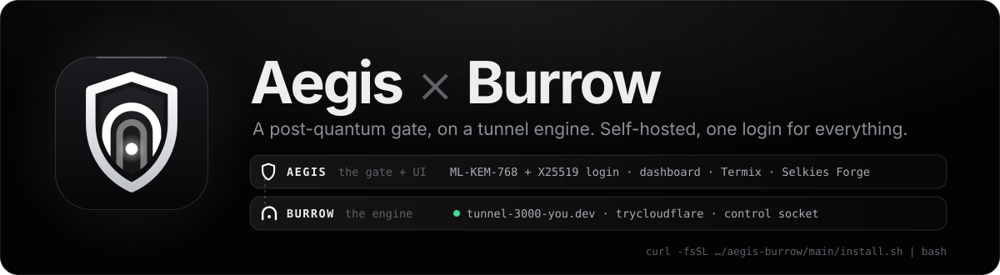
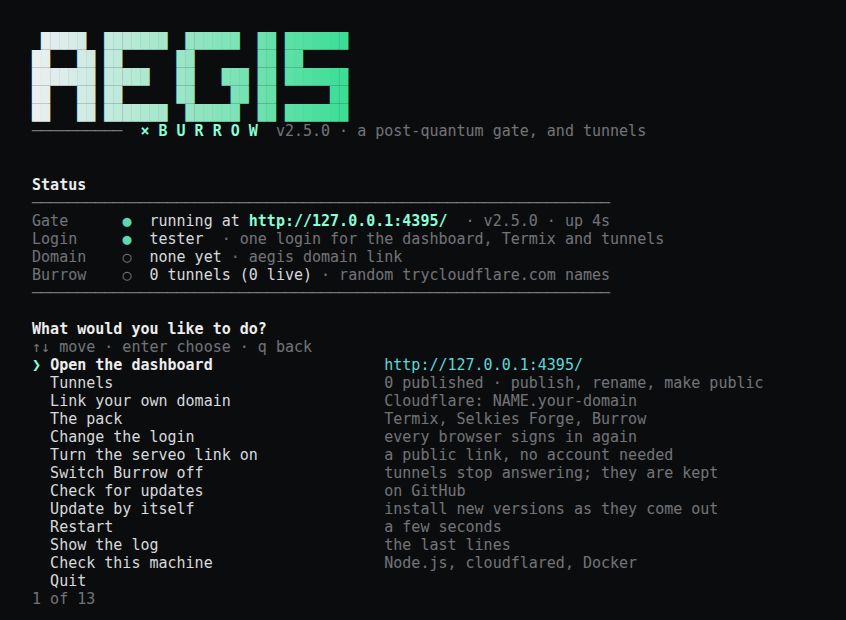
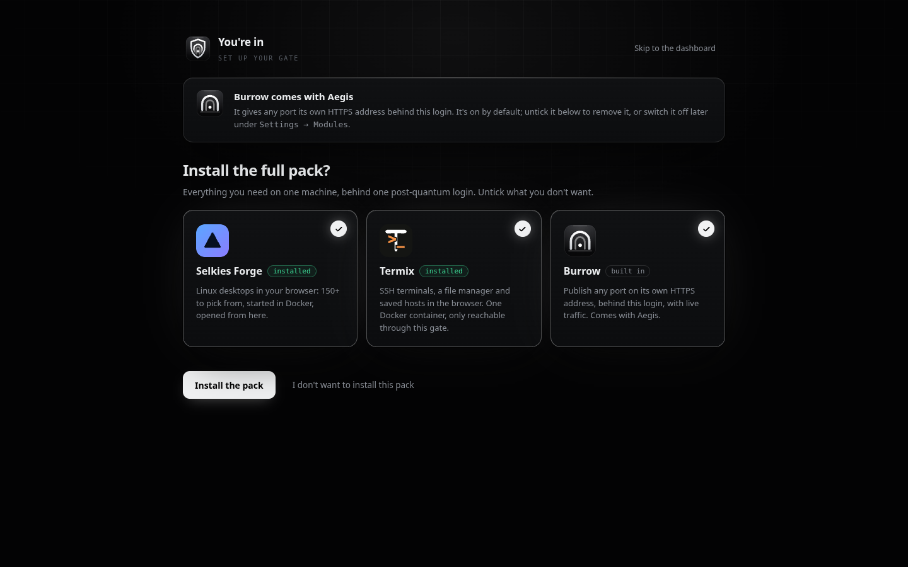
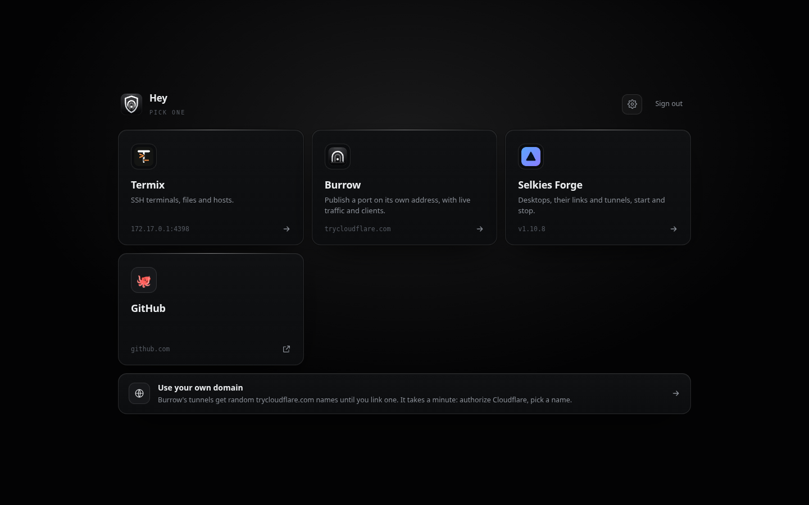
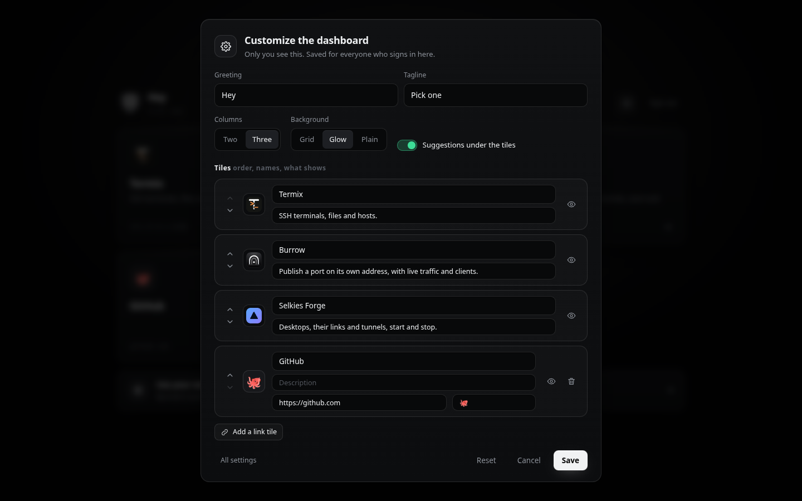
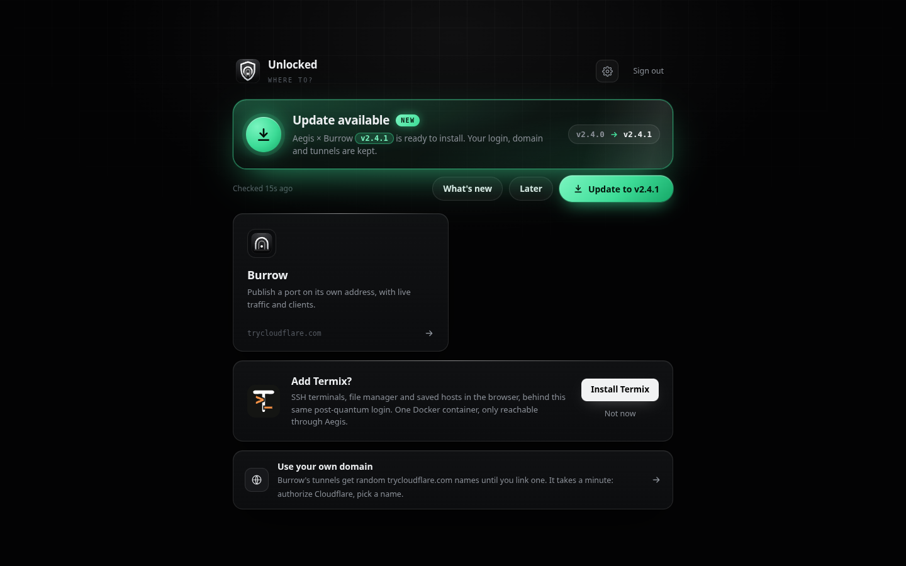
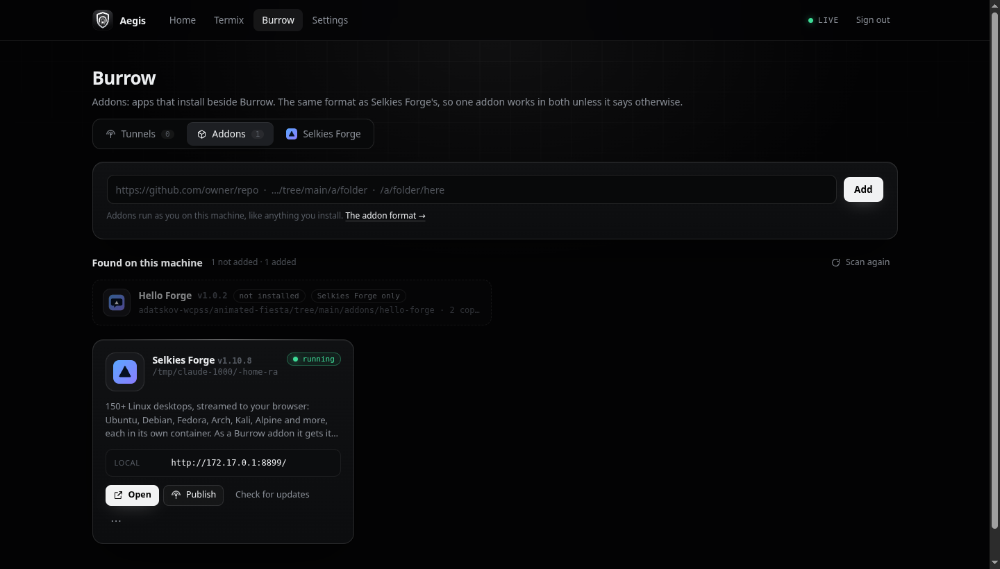
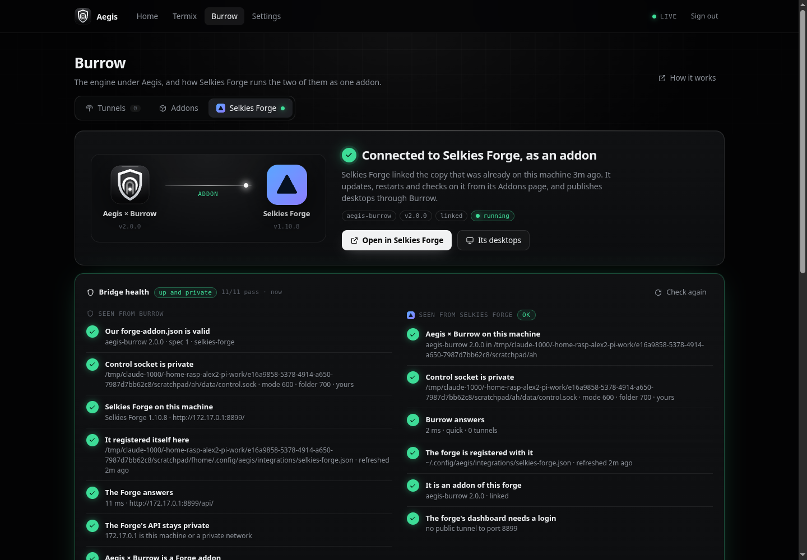

<p align="center">
  
</p>

<p align="center">
  <a href="LICENSE"></a>
  
  
  
  
  <a href="https://github.com/alexd-aero/weft"></a>
</p>

<p align="center">
  <b><a href="#-quick-start">Quick start</a></b> ·
  <b><a href="#-two-halves">Two halves</a></b> ·
  <b><a href="#-burrow-the-engine">Burrow</a></b> ·
  <b><a href="#-addons">Addons</a></b> ·
  <b><a href="#-selkies-forge">Selkies Forge</a></b> ·
  <b><a href="#-the-login">The login</a></b> ·
  <b><a href="#-reference">Reference</a></b>
</p>

---

**Aegis × Burrow** puts one sign-in that nobody, not even Cloudflare, can read in front of everything you run on a machine, and gives any port its own HTTPS address.

- **Aegis** is the gate and the UI: a dashboard you arrange yourself, [Termix](https://github.com/Termix-SSH/Termix) for terminals, [Selkies Forge](https://github.com/adatskov-wcpss/animated-fiesta) for Linux desktops, and your own links.
- **Burrow** is the engine underneath. It runs the tunnels, the Cloudflare link and the addons. Burrow is on by default, and you can switch it off.

Link your own domain with one Cloudflare authorization, or use free `trycloudflare.com` addresses.

```bash
curl -fsSL https://raw.githubusercontent.com/alexd-aero/aegis-burrow/main/install.sh | bash
```

## ⚡ Quick start

<table>
<tr>
<td width="50%" valign="top">

**1 · Install.** The line above finds Node.js 18+ (or downloads a private copy) and `cloudflared` (or downloads it), installs into `~/.local/share/aegis`, and starts a systemd user service.

**2 · Set it up: here, or in a browser.** At the end the installer asks:

```
  Where would you like to set it up?
  ❯ Here, in this terminal               step by step, a minute or two
    In a browser                         on this machine, or your phone through the serveo link
```

**In this terminal**, it asks for your login (the password is never echoed), then the pack, then (if you like) a domain, where you authorize Cloudflare from any browser and type the subdomain. **In a browser**, it prints the setup links:

```
  Create your login in a browser, from this machine or anywhere:
    local   http://127.0.0.1:4310/__gate/setup
    serveo  https://1a2b3c….serveousercontent.com/__gate/setup
```

The **serveo** link works from any device, with no account and no domain; what you type there is sealed with ML-KEM-768 before it leaves the page. `--setup cli` or `--setup browser` skips the question.

**3 · Pick your pack.** Aegis offers Selkies Forge, Termix (with a login you choose right there) and Burrow. Take all of it, some of it, or none.

**Using Selkies Forge?** Open *Burrow → Selkies Forge* and press **Add it for me** (it asks first). Or paste `https://github.com/alexd-aero/aegis-burrow` under the Forge's *Addons* yourself.

</td>
<td width="50%" valign="top">

```bash
# the home screen: status, then arrow keys
aegis

# set it up here, or later again
aegis setup

# on another port, on your LAN / Tailscale address
./install.sh --port 4310 --bind 100.64.0.5

# is it up, where is it
aegis status
aegis url

# Burrow, the engine
burrow status
burrow publish 3000 --name "my app"
burrow list

# every address it answers on: domain, local, serveo
aegis serveo on | off | url

# the first-run link, Termix, checks
aegis setup-link
aegis termix install
aegis doctor --fix
```

</td>
</tr>
</table>

## ⌨️ The command line

<p align="center"></p>

`aegis` on its own opens the **home screen**, in the same style as `selkies-cli`: a status block (gate, login, domain, serveo, Burrow, Termix, Selkies Forge, updates), then an arrow-key menu that suggests what's next. Set it up, update, open the dashboard, manage tunnels, link or rename the domain, run the pack, change the login, switch serveo, Burrow or auto-update on and off, restart, read the log, check the machine.

Everything the browser does, the terminal does too. It talks to the running gate over `data/control.sock`, which only your user can open:

| Command | What it does |
|---|---|
| `aegis` | The home screen |
| `aegis setup` | Your login, the pack, a domain: step by step |
| `aegis tunnels` | Pick a tunnel with the arrow keys: change its subdomain, choose who can open it (your login, its own password, anyone), pause it, open it, unpublish it. **+ Publish a port** lists what's listening; **+ Secure reverse tunneling** appears when that experiment is on |
| `aegis domain [link \| rename NAME \| unlink]` | Cloudflare from the terminal: it prints the authorization link (open it on any device) and waits |
| `aegis passwd` | A new login; every browser signs in again |
| `aegis update [--check]` · `aegis update auto on\|off` | What's new, then install and wait for the restart |
| `aegis open` | The dashboard's links (and opens it, on a desktop) |

Under Selkies Forge, or with no keyboard (`curl … \| bash` in a script), nothing is asked: the links are printed instead.

## 🧩 Two halves

```
 browser ──HTTPS──▶ Cloudflare ──▶ cloudflared ─┐
                                                 ▼
 ┌──────────────────────── Aegis × Burrow ────────────────────────┐
 │  aegis/   the gate: post-quantum login, sessions, every page,   │
 │           the dashboard, Termix proxy, the pack, the bridge     │
 │  ───────────────────────────────────────────────────────────── │
 │  burrow/  the engine: tunnels (tunnel-PORT-you.dev or quick),   │
 │           Cloudflare link, traffic stats, addons, control.sock  │
 └────────────────────────────────────────────────────────────────┘
        ▲ data/control.sock (600)              ▲ ~/.config/aegis/integrations/
        └── Selkies Forge, the burrow CLI      └── apps plug in here
```

**Burrow has no login of its own.** Aegis decides who reaches a tunnel: login-protected unless you make it public. In the code it is two folders, `aegis/` and `burrow/`, and one process.

## 🎁 The first run

<p align="center"></p>

Right after you create your login:

- **Burrow comes with Aegis.** It's on by default. Untick it here, or switch it off later under *Settings → Modules*. Your tunnels are kept while it's off.
- **Install the full pack?** Three cards. Termix and Burrow start ticked; **Selkies Forge is only installed if you tick it.** What's already here is found and linked rather than installed twice: Termix on any port (Burrow's port scan, or a page titled Termix), and a Selkies Forge that's installed or answering on any port. An older standalone Burrow (from before the merge) is pointed out too, with how to remove it.

  | | |
  |---|---|
  | **Selkies Forge** | 150+ Linux desktops in the browser. Its installer runs unattended, and it becomes a Burrow addon. |
  | **Termix** | SSH terminals, files and saved hosts. One Docker container bound to `127.0.0.1`. You choose **its own username and password** on the same page, sealed on the way like your login, and that account becomes Termix's admin. |
  | **Burrow** | The engine, on. |

  Or press **I don't want to install this pack**. *Settings → Modules → Open the pack* brings this page back.
- **Your own address (optional).** Connect Cloudflare and pick the dashboard's subdomain, any name you like (`aegis`, `home`, `private-termix`…), right on this page. Until then the dashboard answers on this machine and its serveo link; once a domain is linked, the serveo link sends visitors on to the domain.

## 🎛️ Your dashboard

<p align="center"> </p>

The **gear** on the home page opens **Settings**. There, *Sign-in → Customize the home page* opens *Customize the dashboard*:

- greeting and tagline;
- two or three columns;
- background (grid, glow or plain);
- every tile moved, renamed, re-described or hidden;
- link tiles of your own, with an emoji or an image;
- suggestions on or off;
- **Reset**.

Everything else lives in **Settings**:

| Section | What you can change |
|---|---|
| **Sign-in** | The gate's name, the line on the sign-in page, how long a sign-in lasts, the lockout after wrong tries |
| **Updates** | Check for a new version and install it in one click; **Update by itself** on or off |
| **Changelog** | What changed lately in Aegis × Burrow, Selkies Forge and the Weft Architecture, release by release |
| **Modules** | Burrow on or off; **machine management** on or off; the **serveo link** on or off (with its address); the pack |
| **Domain** | Link a domain through Cloudflare with the subdomain you pick, **change that name later**, or unlink it. **Other domains** beside it, each with **subdomains** of its own: a wildcard one (`*.apps.other.net`, every tunnel at `NAME.apps.other.net`, through your VPS) or one tunnel's (`blog.other.net`). The gear by each domain in the dashboards menu (home page, top right) opens its settings |
| **Termix** | Install, open, remove (its data volume is kept) |
| **Login** | Your username and password |
| **Connected apps** | Apps that plugged in |
| **Advanced** *(folded away at the bottom)* | **Where apps live**: serve Termix or Selkies Forge under a path of the dashboard, like `/__gate/termix`, instead of at the root (Termix) or its own address (the Forge) |

**Search all settings**: the button at the top of Settings, or <kbd>/</kbd> or <kbd>Ctrl</kbd>+<kbd>K</kbd>, finds any setting by the words you'd use for it (`password`, `subdomain`, `auto-update`, `path`…) and takes you there.

### Apps under a path

Termix normally answers at the root of the dashboard's address (the home page stays at `/`), and Selkies Forge at its own address. Under *Settings → Advanced → Where apps live* either one can move under a path instead, like `https://private-termix.example.com/__gate/termix/` or `/__gate/forge/`, behind the same login:

- **Termix** is told its base path (its page carries a `termix-base-path` setting), so its API and terminals follow it there. The root then always shows the home page.
- **Selkies Forge** is served through the gate; what its page asks for at absolute paths (`/api/…`, `/app.js`) is recognised by where it came from. Its own address keeps working on the machine.
- Paths are `/name` or `/__gate/name`; Aegis's own pages (`/__gate/login`, `/__gate/settings`…) can't be taken, and two apps can't share one. Burrow's tunnels always keep addresses of their own.

## 🖧 Machine management

*Off until you switch it on, in Settings → Modules.* Other machines you own, run from this dashboard.

**Linking one** takes a single command. The dashboard hands it to you; you run it on the other machine:

```sh
curl -fsSL "https://your-dashboard/__gate/fleet/join?t=…" | sh
```

**One command is all it ever takes.** Besides the key, the script makes sure an SSH server runs there (installing one only when `sudo` works without a password), and — with Python 3, which nearly every Linux has — starts a small **agent** as a user service. The agent keeps one outgoing WebSocket open to this dashboard's own address (the same HTTPS a browser uses, signed with that machine's own key), and when this gate can't reach the machine's SSH directly — another network, behind NAT, a firewall — SSH runs through it instead, to that machine's own `127.0.0.1` and nothing else. Nothing is opened on either side; the panel says *through its agent* when that is the way in. Forgetting the machine takes its key off and removes the agent too (and an agent whose machine was forgotten removes itself).

**A VPS you added for the tunnels is a machine too.** Once its relay agent is linked (Settings → Domain → Your VPS, the wildcard tunnels or another domain's), it runs the same link script there itself, as root — or, when its SSH server doesn't let root in, as the admin user who ran `sudo` — and the machine agent runs as a system service. No second command: it shows up in Machines as *name (VPS)* with its specs, apps and a terminal. A VPS linked before this gets the newer relay agent over the link and joins the same way. Forget it in Machines and it stays out until the relay is set up again.

The link is good once, for half an hour, and the dashboard shows you the script before you run it. It appends **one** public key — Aegis makes itself an `ed25519` key the first time, kept in `data/fleet/` — to that user's `~/.ssh/authorized_keys`, then tells this dashboard the machine's name, the addresses it answers on and its SSH port. Nothing else leaves it, and it is never asked for a password. A machine whose `authorized_keys` already has the key can be added by hand instead, with any address that reaches it: a domain, a LAN or subnet address, a public address, a Tailscale name, a bare hostname.

**Machines** then shows up under Burrow, drawn like a workflow editor (Bulwark's Patterns page, n8n): **this gate → your machines → what runs on them**, cards on a dotted canvas joined by lines that are green while a machine answers, red when it doesn't and gold for the standby. Hover to trace a line, drag to move, scroll to zoom, **Fit**, **Tidy up**, **Full screen** (`F`); a phone gets the same machines as a list. Every machine is checked in the background once a minute, and only shows as down after three misses in a row. Click a machine for:

- **What it is made of**: system, model, cores, memory, disk, how long it has been up.
- **How loaded it is**: processor, memory, disk and temperature, read live over the link.
- **What runs on it**: Aegis × Burrow, Selkies Forge, Bulwark and Termix are recognised by name and version, with **what each one uses right now** (processor and memory, from its container or its service) and a link to open each; everything else it runs is there too: every container with its ports and use, every service, every disk and every address it answers on.

**This machine** (the hub in the middle) has the same panel — its specs, load, disks, containers, the apps on it with their use and a **Manage** link to each one's page here — and **Open Termix**. Click an **app** and you see every machine it runs on, what it uses there next to how loaded that machine is, and **Manage** / **Move**.
- **Install an app on it** — the project's own published installer, run over the link, its output in front of you.
- **Add to Termix** — adds it to Termix as a host (address, SSH port, user). It asks first, every time: Termix's own login is used once and never kept, and the machine signs in with this gate's key unless you give it a password instead.
- **Terminal** — once it is in Termix, opens a new tab straight into a terminal session on it (Termix's `?view=terminal&hostId=…`).
- **Move an app** — one app and its data to another machine, as a **copy** (both run it after) or a **move** (only the new one does; the old one keeps its data, stopped and no longer started at boot). The new machine gets the app first if it doesn't have it, and whatever it had is moved aside, never deleted. Click an app's card to see every machine it runs on and move it from there.
- **Swap an app with another machine** — Selkies Forge on A and the one on B change places, data and all. Both are stopped first and started again after, and neither machine's old data is deleted: it is kept beside the new one.
- **Forget** — takes the key back off the machine and drops it. Nothing installed on it is touched.

### Moving the whole gate

**Move this gate to another machine** (on the hub, or the Aegis × Burrow card) hands everything this dashboard is to a linked machine: the login, the domain and its tunnel, every tunnel, the addons and their settings, the certificates and the machines. The machine gets Aegis × Burrow first (its own installer) if it doesn't have it — or the one it has is stopped and its config and data put aside, never deleted. Paths are rewritten for the new home, this machine becomes one of the new gate's machines (so you can move back from there), and on its first start the new gate **starts every addon whatever it takes** (their services are installed there if they have to be). Only once it answers does this machine step aside: it then serves a notice saying where the gate went, and nothing else. `aegis resume-here` on the old machine undoes that.

Apps that run beside the gate (Termix, Selkies Forge) stay where they are — move them with **Move an app**. A domain whose tunnel is run by a cloudflared service outside Aegis can't move with it (its traffic would keep arriving at the old machine); link the domain from Aegis itself first.

### The standby

One linked machine can keep a **copy of this gate**: its code, this login, the domain and the tunnels, refreshed a few times a day. The copy does not run. A small watcher on that machine checks this host every half minute, and if it misses four checks in a row it starts the copy, says in its own dashboard what went wrong, and — only while this host is answering at all — runs a restart script on it, trying every way this machine might start Aegis. When this host is back for three checks running, the copy steps aside again.

This gate's **machine key is not copied**: a standby cannot reach your other machines. The watcher gets a key of its own, allowed in here only to run that restart script, and taken away again when you switch the standby off.

## 🕳️ Burrow, the engine

**Burrow → Tunnels** publishes any port at its own HTTPS address: `tunnel-3000-aegis.example.com` with a linked domain, or a random `trycloudflare.com` name without one. **Or give it a subdomain of its own**: type `grafana` under *Address* when you create or edit a tunnel, and it lives at `grafana.example.com`. Burrow never takes over a DNS record that isn't its own (your `www`, your mail). Every tunnel shows:

- live requests and bandwidth;
- latency percentiles and status codes;
- its clients, with kick, block and pause.

**Who can open a tunnel** is up to you, per tunnel:

| | |
|---|---|
| **Aegis login** (the default) | The login you sign in to the dashboard with. One sign-in covers every tunnel. |
| **Its own password** | A password just for this tunnel, to share with someone who shouldn't have your login. Your login still works there too. It is sealed in the browser on its way (like the login) and kept only as a scrypt hash; a new password signs out everyone who had the old one. |
| **Public** | Anyone with the link. |

### Tunnel names two levels deep, free, with nothing open at home

**Settings → Domain → One wildcard record** puts every tunnel at `NAME.tunnel.example.com`. Cloudflare's free certificate stops one level short of that, so pick who holds the certificates:

| | |
|---|---|
| **Cloudflare Worker** (the default) | Every tunnel name becomes a [Workers Custom Domain](https://developers.cloudflare.com/workers/configuration/routing/custom-domains/) of one small Worker, which Cloudflare gives a certificate for exactly that name, at any depth, for free. The Worker hands each request to Aegis through the dashboard's own Cloudflare tunnel, with a secret only the two of them know. No port is open at home and your address is never in DNS. A new name gets its certificate within a few minutes. **Setup is one click**: pick the wildcard, press *Connect Cloudflare & move every tunnel*, click *Allow* on Cloudflare's page (its login for the `wrangler` tool), and Aegis puts up the Worker and every name by itself. From a terminal: `aegis front-login --wildcard tunnel`. An API token with *Workers Scripts: Edit* and *Workers Routes: Edit* works too. |
| **This machine** | Aegis gets a Let's Encrypt certificate for `*.tunnel.example.com` itself (proved through your Cloudflare DNS, renewed 30 days early) and serves the tunnels on port 443 (8443 when it may not listen there). Needs port 443 forwarded to this machine; Aegis asks over UPnP and checks from the outside, through Cloudflare. |
| **A relay server** | A server of yours with Caddy (on-demand TLS) answers for the names and passes requests here over a reverse SSH tunnel. |
| **Cloudflare** | Through Cloudflare's proxy, if your plan covers two levels (Advanced Certificate Manager), or with no prefix at all (`*.example.com`). |

### Burrow Pages: your repositories behind a password (an addon)

[**Burrow Pages**](https://github.com/alexd-aero/burrow-pages) comes with Aegis × Burrow: it installs itself once (uninstall it and it stays gone) and has its own card on the Burrow page.

- **Your domain, checked.** It looks at whether your domain is linked, and whether anything on it already points at GitHub or GitLab Pages, and for which account. Those accounts are added for you; remove them, or add others by **username**.
- **Sign in with GitHub** with a code at [github.com/login/device](https://github.com/login/device), and private repositories show up too.
- **Static websites only:** HTML, CSS, JavaScript and images, already built (or a Jekyll site GitHub Pages builds). Apps that need a server won't run.
- **Repositories sorted by commits and recent activity.** Pick one and a subdomain, and Burrow serves its files itself (a `gh-pages` branch, `/`, `docs/`, `dist/`…). Private repositories stay private, and it follows every push. Sites that need building (Jekyll) are served from their Pages site.
- **Behind your login** or a password of the site's own; never public.
- A Pages address that's already live (`you.github.io/project`) works too: **+ A Pages address**.

### Clone a link from another Aegis × Burrow

**New tunnel → Clone a link** puts someone else's Aegis × Burrow tunnel on an address of yours. Paste the link and Burrow asks it who may open it (`/__gate/burrow`):

- **Public:** cloned as it is. Anyone could open it anyway.
- **A password of its own:** type it once. It travels sealed (ML-KEM-768 + X25519, like every Aegis password) and buys a **clone key**, which your gate sends with every request. The password itself is never stored. The clone stays locked too: by default it gets the same password, or you can give it your login or another password. It can't be made public. When the owner changes the password, every clone is cut off at once and shows a "cut off" page until someone types the new password. The owner gets a notice on their bell for each clone.
- **Behind its owner's Aegis login:** can't be cloned. Only the owner gets in, so a copy would be a way around that.

The clone fetches the original over HTTPS with its certificate checked, WebSockets included. Nothing about your visitors (their IP, Cloudflare headers) is passed on. Both gates need 2.30 or later. From a terminal: `burrow clone radio.tunnel.friend.dev --sub radio` (its password is asked, or read from the first line of stdin).

The engine also answers on **`data/control.sock`**, a Unix socket only your user can open. That is how [Selkies Forge](#-selkies-forge) and the `burrow` command work without a browser:

```bash
burrow status                       # Burrow 2.0.0: on, 3 tunnels (3 live), tunnel-PORT on alexaero.dev
burrow list
burrow publish 8790 --name hello    # login-protected; --public for anyone
burrow publish 3000 --sub grafana   # at grafana.<your zone>
burrow publish 8080 --password      # its own password (asked, or the first line of stdin)
burrow password 8080                # change it; burrow access 8080 login|password|public
burrow site github.com/you/project --sub docs --password   # a Pages site (experimental)
burrow clone radio.tunnel.friend.dev --sub radio            # another Aegis × Burrow link (public or password)
burrow rename 3000 dashboards       # move it; "" goes back to tunnel-3000-…
burrow unpublish 8790
burrow off / on                     # the module switch (tunnels are kept)
```

**Your own domain:** *Settings → Domain → Connect Cloudflare* (or the first-run page) shows Cloudflare's own authorization link. Pick your zone and a name: `aegis` is only the suggestion, type any other. Burrow then:

1. creates a named tunnel;
2. adds a proxied CNAME for `aegis.<zone>`;
3. runs `cloudflared --post-quantum` itself.

Each tunnel gets its own DNS record. *Change the name* moves the dashboard to another subdomain on the same tunnel (tunnels named `tunnel-PORT-…` move with it), and *Unlink* removes the records, the tunnel and the files. A domain routed by a cloudflared service you set up yourself can be renamed too: Aegis reads that service's config first and only goes ahead when its ingress already sends the new name here (a `*.<zone>` rule does).

## ⬆️ Updates

<p align="center"></p>

Aegis × Burrow checks GitHub for a newer version 20 seconds after it starts, every 30 minutes after that, and whenever a page opens (when the last check is more than two minutes old), so a new version shows up right away. When there is one, every page shows the green **Update available** card: the version going from → to, *What's new*, and **Update**. One click downloads it (size-capped, unpacked into a fresh folder, checked to be a whole, newer Aegis × Burrow), swaps it in for `app/` (the old code stays as `app.prev`), and restarts. The page waits and reloads itself, and greets you with **You're up to date**. Your login, domain, tunnels and addons live in `data/` and are kept.

- **Update by itself** (*Settings → Updates*): install new versions as soon as they're found.
- From a terminal: `aegis update` (or `aegis update --check`).
- Installed as a Selkies Forge addon? Either works; the Forge's own *Update* does the same.

## 🔗 The serveo link

Aegis × Burrow opens `ssh -R 80:localhost:PORT serveo.net` itself and keeps it up. That gives the dashboard a public `https://…serveousercontent.com` address, from a key of its own in `data/serveo/` so the name stays the same.

- **When it's on.** By default, so a first run is reachable from your phone. Once a domain is linked, opening the serveo link sends you on to the domain (signed in, if you were); switch *Send its visitors on to the domain* off under *Settings → Modules* to keep it a dashboard of its own (handy where the domain doesn't load, like your own network). Switch the link off there too, or with `aegis serveo off`.
- **Its name changes.** Serveo gives it a new random name every time Aegis restarts; *Settings → Modules* and `aegis serveo url` show the current one.
- **It goes through the same gate as everything else.** Serveo's visitors count as remote, never as "this machine", even though serveo connects from loopback. The setup page is open from anywhere for 30 minutes after Aegis starts (and from this machine any time; `aegis restart` opens the 30 minutes again), sign-in needs your password, and the lockout counts each visitor's real address.
- **Serveo's warning page.** Serveo shows its own *Browser Warning* the first time a browser opens a free tunnel; press *Continue to Site*.

## 📦 Addons

<p align="center"></p>

**Burrow → Addons** installs apps beside Burrow. **Everything is powered by the [Weft Architecture](https://github.com/alexd-aero/weft)**: the same addon format as Selkies Forge, a `forge-addon.json` and a few bash scripts, read with the same rules, run with the same environment, and talking back with the same `::progress`, `::open` and `::warn` lines. One addon works in both unless its manifest says otherwise:

```json
"platforms": ["selkies-forge", "burrow"]    // the default; name one to stay on that host
```

- **Paste a link.** Any of these works:
  - a repository on GitHub, GitLab (subgroups and self-hosted too), Codeberg, or any git URL;
  - a folder in one (`…/tree/main/a/folder`, GitLab's `…/-/tree/…`, or a `/blob/` link to its `forge-addon.json`);
  - a **`.zip` / `.tar.gz` download**, inspected statically first: unpacked into a fresh folder with size limits, refused if anything could escape it, then its manifest validated before anything runs. The name can sit anywhere in the link (`/download/addon.tgz`, `?file=addon.zip`);
  - a **direct download link with no extension at all** - `files.example.com/9a3b/download`, the kind a file-sharing site hands you. A link that is not plainly a repository is fetched and judged by its bytes, so an archive installs and anything else says so instead of failing as a bad repository. An archive holding nothing but another archive (a `.zip` of the `.zip` you uploaded) is unpacked again, up to three deep;
  - a folder on this machine. The addon shows up as a card. Install it, open it, run its actions, check for updates against its git commits, and uninstall it. An addon whose status reports a port gets **Publish**, which gives it a Burrow address.
- **Start it.** An addon that is stopped or whose status check fails says why on its card, with a **Start it** button. Start it tries every way the addon can be started, checking its status after each: its own `start`/`restart` action, a start script it ships, its systemd service (yours, then the system's with `sudo -n`), its Docker containers, and finally its install script again as a repair. Whatever happens it writes a **start report** — this machine, the addon, what each attempt printed, the status before and after, and when it still won't run, its journal, container logs, its own `*.log` files, disk, memory, out-of-memory kills and listening ports — that you can read, **copy** or **download**. The last five are kept (`⋯ → Start reports`).
- **Found on this machine.** Opening *Addons* scans your home, `/opt`, `/srv` and the code folders apps declare. It lists every valid addon it finds, **running, stopped or not installed**, using each one's read-only `detect` and `status` scripts. Addons already in the list aren't repeated. Addons made for another host are shown greyed out.

Scripts get the universal `ADDON_*` names (`ADDON_ID`, `ADDON_DIR`, `ADDON_DATA`, `ADDON_SETTING_<KEY>`, `ADDON_HOST=burrow`…), the older `FORGE_ADDON_*` twins, `BURROW_SOCKET` and `BURROW_NODE`.

**Addons that need root.** A manifest with `"requires": {"root": "why"}` (install, update and uninstall need root) or an action with `"root": true` gets a **needs root** chip on its card. Before such a job, Aegis checks `sudo -n`: with passwordless sudo it only warns and asks to go on; otherwise it asks for your password, checks it with sudo, and keeps it **in memory for that one job** (an hour at most): never on disk, in logs, in the job's output or in an environment. The script gets `ADDON_ROOT=1`, `ADDON_ASKPASS_TOKEN` and `SUDO_ASKPASS` (`bin/aegis-askpass`) and runs `sudo -A …`. `aegis addons install|update|uninstall ID` asks the same in the terminal. Nothing automatic (default addons, the watchdog, Start it) ever runs a root step: it leaves a notice on the bell instead. Aegis can't give root when its own systemd unit sets `NoNewPrivileges=` or `ProtectSystem=`: the dialog says so.

**Addons that extend Burrow.** A manifest may add `"burrow": {"extension": "x.mjs", "ui": "y.js"}`: Burrow runs the extension inside itself while the addon is installed (with a context: its data folder, its settings, the domain and its DNS records read-only, and the tunnels it made), answers `/__gate/api/x/<id>/…` and `/x/<id>/…` on the control socket with it, and shows the UI module as a card on the Burrow page. Other hosts ignore the field. [Burrow Pages](https://github.com/alexd-aero/burrow-pages) is built this way. **Start here:** [the Weft Architecture](https://github.com/alexd-aero/weft). It has the spec, **[stable example addons that link to each other](https://github.com/alexd-aero/weft#-the-examples)** (Beacon, Pulse, Relay for Burrow, Shelf for the Forge), `weft-check`, `weft-run`, and [a strict brief for AI agents](https://github.com/alexd-aero/weft/blob/main/prompt.md). The Forge's [addon guide](https://github.com/adatskov-wcpss/animated-fiesta/blob/main/docs/addons.md) covers the details.

## 🖥️ Selkies Forge

<p align="center"></p>

Aegis × Burrow and Selkies Forge each become **the other's addon**, and either side can start it:

| From | Do | Then |
|---|---|---|
| **Selkies Forge** | *Addons* → paste this repository (or *Add and link* under *Found on this machine*) | The Forge links the copy that's already here. Burrow sees it and adds the Forge as one of its own addons, from the Forge's checkout. |
| **Burrow** | *Burrow → Selkies Forge → **Add it for me*** | Burrow first lists exactly what it will do and waits for **Allow**. Then it checks its own `forge-addon.json` with the Forge's rules, the Forge adds and links it (with its live log shown in Burrow), and Burrow adds the Forge. Prefer to do it yourself? **I'll do it myself** shows the link and the button to press |
| **Burrow** | *Burrow → Addons* → *Add and link* on Selkies Forge | The same, from the other end. |

Once linked:

- **The Forge** lists Aegis × Burrow among its addons.
- **Burrow** lists the Forge among its own, with its desktops (each with its distro's logo, the same marks the Forge shows), their links, start/stop/restart and one-click **Publish**.
- **The Forge's Open desktop** button offers each desktop's Burrow address.

The **Selkies Forge** tab only appears when a Forge is actually on this machine (its drop-in is fresh, or its install is on disk). Without one, Burrow never suggests installing it or adding it. The tab shows:

- which version and commit the Forge installed, and whether it linked it;
- whether an update waits, with **Update in Selkies Forge**;
- what the Forge can run: lifecycle scripts, actions and settings;
- every call it made on the control socket.

**Bridge health**, on both sides, says whether the link is **up and private**:

| Check | Why it can fail |
|---|---|
| Control socket is private | Missing, not a socket, not yours, not mode `600`, or in a folder others can enter |
| Both sides answer | The socket or the Forge's API doesn't respond |
| The Forge registered itself | Its drop-in is stale, or writable by anyone but you |
| Each side has the other as an addon | One side hasn't added the other yet; **Add it** fixes it (after asking) |
| The Forge's API stays private | It answers on an address that isn't loopback, a private network or Tailscale |
| The Forge's dashboard needs a login | Warns when a Burrow tunnel publishes it to anyone |
| Our manifest is valid, and versions fit | The checks *Add it for me* relies on |

Burrow's tab shows both views side by side: *Seen from Burrow* and *Seen from Selkies Forge*. The Forge shows its own at the top of *Addons*.

Any other app can plug in the same way. It drops `~/.config/aegis/integrations/<id>.json` with `{spec, id, kind, name, version, url, port, logo}`, and Aegis reads the folder on every request.

## 🔐 The login

```
ss       = X-Wing shared secret       (ML-KEM-768 + X25519; the server key pair is single-use)
K_inner  = HKDF-SHA384(ss, salt = challenge id, "aegis/v1/inner")
K_outer  = HKDF-SHA384(ss, salt = challenge id, "aegis/v1/outer")
payload  = AES-256-GCM(K_outer, AES-256-GCM(K_inner, {username, password}))
```

- **Sealing in the browser.** It is pure JavaScript ([noble](https://paulmillr.com/noble/)), so it works on LAN and Tailscale addresses where browsers hide `crypto.subtle`. The pack's Termix password and password changes are sealed the same way.
- **Passwords** are stored as scrypt (N=2¹⁵), with a configurable lockout.
- **Sessions** are AES-256-GCM sealed tokens bound to their host. **One login per browser:** login-protected tunnels sign in through the dashboard with single-use 60-second tickets.
- **A tunnel's own password** is entered on the tunnel's address (sealed the same way), counts toward the same lockout, and opens a cookie bound to that tunnel, its host and the password's version.
- **TLS.** With `tls` set, the server speaks TLS 1.3 with X25519MLKEM768 and AES-256-GCM only.

## 📖 Reference

<details>
<summary><b><code>aegis</code> and <code>burrow</code> commands</b></summary>

| Command | What it does |
|---|---|
| `aegis install [--port N] [--bind ADDR] [--home DIR] [--termix] [--no-start] [--setup cli\|browser]` | Install, or upgrade in place (keeps the login, settings, tunnels and addons) |
| `aegis upgrade` | Copy this checkout's code over the installed one and restart |
| `aegis` · `aegis setup` | The home screen · set it up here (login, pack, domain) |
| `aegis update [--check]` · `auto on\|off` | Fetch the newest version from GitHub and install it (or just say whether there is one) · install by themselves |
| `aegis tunnels` · `domain [link\|rename NAME\|unlink]` · `passwd` · `open` | Tunnels with the arrow keys · the domain · a new login · the dashboard's links |
| `aegis uninstall [--purge]` | Stop and remove; `--purge` also deletes the login, tunnels and Cloudflare credentials |
| `aegis start` · `stop` · `restart` · `status [--json]` · `url` · `setup-link` · `logs [-f]` | The usual |
| `aegis termix install` · `remove` | Termix in Docker, behind the gate |
| `aegis doctor [--fix]` | Check (and fetch) Node.js and cloudflared; check Docker |
| `aegis burrow …` = `burrow …` | `status` · `list` · `on` · `off` · `publish PORT [--name N] [--sub NAME] [--public \| --password] [--host H]` · `password PORT` · `access PORT login\|password\|public` · `site URL --sub NAME [--password]` · `rename PORT NAME` · `unpublish PORT` |

</details>

<details>
<summary><b>Files and settings</b></summary>

```
aegis/                           the gate and the UI (server.mjs is the entry point)
burrow/                          the engine: index.mjs, tunnels.mjs, cloudflare.mjs, addons.mjs
public/                          the pages
forge-addon.json  forge/         how Selkies Forge installs, links and runs it

~/.local/share/aegis/            AEGIS_HOME
  app/  node/  bin/              the code; private Node and cloudflared when the machine had none
  config.json                    written once by the installer (listen, tls, cookie…), never by the server
  secret.key                     seals the session cookies
  data/state.json                everything you change in the UI
  data/tunnels.json  metrics.json  favicons/  revoked.json  cf/  control.sock  addons.json
  data/addons/<id>/repo  data/addons/<id>/data     Burrow's addons
  data/fleet.json  data/fleet/id_ed25519           the machines you linked, and the key that reaches them
~/.config/aegis/aegis.json       where all that is (Selkies Forge reads it)
~/.config/aegis/integrations/    where other apps plug in
```

| `config.json` key | Default | |
|---|---|---|
| `listen` | `{"host": "127.0.0.1", "port": 4310}` | `AEGIS_BIND` / `AEGIS_PORT` override it |
| `tls` | `null` | `{"key", "cert"}` to serve HTTPS |
| `cookie` | `"__Host-aegis"` | The session cookie over HTTPS |
| `extraHosts` | `[]` | More names that reach the dashboard |
| `termix` | `null` | `{"upstream": "https://127.0.0.1:4300"}` to use a Termix you already run |
| `domain` | `null` | `{"mainHost", "tunnelId", "cert", "managed": false}` for a tunnel you run yourself |

A deep `AEGIS_HOME` whose socket path would be over 100 bytes gets the socket in `$XDG_RUNTIME_DIR/burrow-<uid>/`, and `data/control.sock` links to it. The discovery file's `service.scope` can be `user`, `system` (a unit someone wrote by hand; installs point its `ExecStart` at the new code) or `manual` (something else supervises it, and installs never touch services).

</details>

<details>
<summary><b>HTTP API</b> (signed in; changes need <code>X-Gate: 1</code> and a same-origin request)</summary>

| | |
|---|---|
| `GET /__gate/health` | `{ok, app: "aegis-burrow", version, burrow}`, no login needed |
| `GET /__gate/api/me` | Everything the pages need |
| `POST /__gate/api/prefs` | Title, home layout, sign-in settings, `modules: {burrow}` |
| `GET` · `POST /__gate/api/pack` | The pack |
| `/__gate/api/tunnels…`, `/ports` | Burrow's tunnel API (409 while it is off) |
| `GET /__gate/api/addons` · `/addons/scan[?fresh=1]` · `POST /addons/add {source}` | Addons, and what the scan found |
| `POST /__gate/api/addons/<id>/install` `{settings}` · `update` · `uninstall` `{keep_data}` · `remove` · `action` `{action}` · `check` · `share` `{on, access}` | The lifecycle; jobs at `GET /addons/jobs/<id>?since=N`, `POST …/cancel`. A root one takes `{password}`; without it, when sudo asks for one: `428 {needsRoot, reason, passwordless: false}`; a wrong one `403 {badPassword}`; no sudo here `403 {noSudo, why}` |
| `GET /__gate/api/addons/<id>/root` | `{needsRoot, reason, needs: {install, update, uninstall, actions}, sudo, passwordless, why}`: what the dialog opens on |
| `GET /__gate/api/addon` · `/bridge` · `POST /bridge/connect` · `GET /bridge/job/<id>?since=N` | As a Selkies Forge addon; the bridge's health; *Add it for me*; the Forge's job, live |
| `POST /__gate/api/addons/inspect` `{source}` | Fetch and validate a link (git, GitLab, .zip, .tar.gz) without adding it or running anything |
| `/__gate/api/cf…`, `/termix…`, `/integrations…`, `/password` | Domain, Termix, connected apps, the login |

The control socket serves the tunnel API (without `/__gate/api`), plus `GET /status` and `POST /module {burrow}`, the addon routes (`/addons/<id>/install|update|uninstall|action` with the same `{password}`, `GET /addons/<id>/root`) and `POST /askpass {token}` (the askpass helper's: the password of a running root job, text/plain, else 404; only on the socket). Callers name themselves with `X-Burrow-Client: name/version`.

</details>

<details>
<summary><b>Building and testing</b></summary>

The repository ships `public/login.js` and `aegis/vendor/pq.mjs` built, so installs never run npm. After changing `client/` or upgrading noble: `npm install && npm run build`. `npm run check` syntax-checks everything; `npm test` runs the addon host's tests (the same cases as Selkies Forge's).

</details>

## 🌱 Where it came from

Aegis and Burrow started as two repositories: a gate, and a tunnel manager with its own copy of the same login. Here they are one product, with Aegis on top and Burrow underneath. If you ran either, `aegis install` upgrades it in place and keeps your login, domain and tunnels. Selkies Forge lists it under *Found on this machine*, ready to link.

## 🙏 Credits

- **Powered by the [Weft Architecture](https://github.com/alexd-aero/weft)**, the addon format it shares with [Selkies Forge](https://github.com/adatskov-wcpss/animated-fiesta)
- [Cloudflare](https://www.cloudflare.com/) tunnels, [noble](https://paulmillr.com/noble/) for the post-quantum cryptography, [Termix](https://github.com/Termix-SSH/Termix) for terminals

## 💙 It's yours

> [!IMPORTANT]
> **Aegis × Burrow is open source under the [MIT licence](LICENSE).** Use it, change it, fork it, rename it, ship it. You don't need to ask anyone.

<p align="center"><sub>Grew out of a Raspberry Pi's private gate. MIT licensed. Make it yours.</sub></p>
